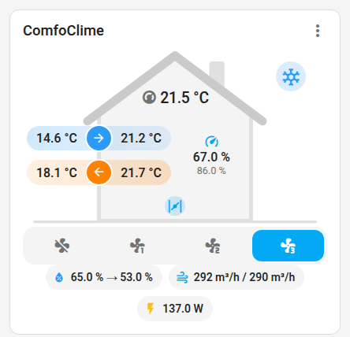

# HAComfoairMQTT Card

A Lovelace card for Zehnder ComfoAir ventilation units. It shows the air flowing into and out of the house with its
temperatures, the target temperature, the air level and the status of the filter, bypass, preheating and season,
and lets you switch the fan speed.

It was written for the [hacomfoairmqtt](https://github.com/adorobis/hacomfoairmqtt) service (ComfoAir 350/550 over
MQTT), but it works with any integration that provides a `climate` entity with fan modes and the usual sensors, for
example the [ComfoClime](https://github.com/msfuture/comfoclime) integration (ComfoAir Q + ComfoClime).



## Installation

### HACS

Add `https://github.com/mweimerskirch/lovelace-hacomfoairmqtt` as a custom repository of type "Dashboard", then
install "HAComfoairMQTT Card".

### Manual

1. Copy `dist/hacomfoairmqtt-card.js` to `config/www/lovelace-hacomfoairmqtt/` (`config/www` is the folder next to
   `configuration.yaml`; it is served as `/local`).
2. Go to Settings → Dashboards → ⋮ → Resources and add `/local/lovelace-hacomfoairmqtt/hacomfoairmqtt-card.js` as a
   "JavaScript module".
3. Reload the browser (on the companion app: Settings → Companion app → Debugging → Reset frontend cache).

After updating the file, change the resource URL (for example `...hacomfoairmqtt-card.js?v=1.0.0`) or clear the
browser cache, otherwise the old version stays cached.

## Configuration

Add the card with "Add card" → "HAComfoairMQTT Card". The card looks for ComfoAir entities and fills in what it finds;
every entity can be changed in the visual editor.

Only `climateEntity` is required. Leave out what your device doesn't have and the card hides it.

| Option                   | Description                                                            |
| ------------------------ | ---------------------------------------------------------------------- |
| `name`                   | Title shown above the card                                             |
| `climateEntity`          | Climate entity with `fan_modes`; the speed buttons call `set_fan_mode` |
| `outsideTempSensor`      | Outside air, entering the unit                                         |
| `supplyTempSensor`       | Supply air, blown into the rooms                                       |
| `returnTempSensor`       | Return/extract air, coming from the rooms                              |
| `exhaustTempSensor`      | Exhaust air, leaving the house                                         |
| `supplyAirLevelSensor`   | Supply air level (%)                                                   |
| `returnAirLevelSensor`   | Return air level (%), only shown if it differs from the supply level   |
| `filterStatusSensor`     | Filter status (`on`/`Full` = replace filter, shown in red)             |
| `bypassValveSensor`      | Bypass valve (`on`/`1`/`open` or a percentage > 0 = open)              |
| `summerModeSensor`       | `on`/`Summer`/`cooling`, `off`/`Winter`/`heating` or `transition`      |
| `preheatingStatusSensor` | Preheating (`on`/`1`)                                                  |
| `outsideHumiditySensor`  | Outside humidity                                                       |
| `insideHumiditySensor`   | Inside (return air) humidity                                           |
| `supplyAirFlowSensor`    | Supply air flow (m³/h)                                                 |
| `exhaustAirFlowSensor`   | Exhaust air flow (m³/h)                                                |
| `powerSensor`            | Power consumption                                                      |

### hacomfoairmqtt

Entity IDs with the default device name `CA350` (since hacomfoairmqtt uses `has_entity_name`, Home Assistant names
them after the device and the sensor name):

```yaml
type: custom:hacomfoairmqtt-card
climateEntity: climate.ca350_climate
outsideTempSensor: sensor.ca350_outside_temperature
supplyTempSensor: sensor.ca350_supply_temperature
returnTempSensor: sensor.ca350_return_temperature
exhaustTempSensor: sensor.ca350_exhaust_temperature
filterStatusSensor: binary_sensor.ca350_filter_status
bypassValveSensor: binary_sensor.ca350_bypass_valve
summerModeSensor: binary_sensor.ca350_summer_mode
preheatingStatusSensor: binary_sensor.ca350_preheating_status
supplyAirLevelSensor: sensor.ca350_supply_air_level
returnAirLevelSensor: sensor.ca350_return_air_level
```

Older installations use `sensor.ca350_outsidetemp`, `sensor.ca350_supplytemp`, `binary_sensor.ca350_filterstatus`,
… These still work; just keep your existing card configuration.

### ComfoClime (ComfoAir Q + ComfoClime)

```yaml
type: custom:hacomfoairmqtt-card
name: Ventilation
climateEntity: climate.comfoclime_24
outsideTempSensor: sensor.comfoclime_24_outdoor_temperature
supplyTempSensor: sensor.comfoclime_24_supply_air_temperature
returnTempSensor: sensor.comfoclime_24_indoor_temperature
exhaustTempSensor: sensor.comfoairq_350_exhaust_temperature
bypassValveSensor: sensor.comfoairq_350_bypass_state
summerModeSensor: sensor.comfoclime_24_season
supplyAirLevelSensor: sensor.comfoairq_350_supply_fan_duty
returnAirLevelSensor: sensor.comfoairq_350_exhaust_fan_duty
supplyAirFlowSensor: sensor.comfoclime_24_supply_air_flow
exhaustAirFlowSensor: sensor.comfoclime_24_exhaust_air_flow
outsideHumiditySensor: sensor.comfoairq_350_outdoor_humidity
insideHumiditySensor: sensor.comfoairq_350_extract_humidity
powerSensor: sensor.comfoairq_350_power_ventilation
```

The entity IDs depend on your device names and areas.

## Upgrading from 0.1.0

Your existing card configuration keeps working unchanged, including the old entity names. Keys that only the old
editor wrote (`fanSpeedSupplySensor`, `fanSpeedExhaustSensor`, `test_gui`) are ignored.

1. Replace the JS file (or update through HACS).
2. Change the resource URL so browsers load the new file, e.g. `/local/lovelace-hacomfoairmqtt/hacomfoairmqtt-card.js?v=1.0.0`.
3. Reload the browser; in the companion app use Settings → Companion app → Troubleshooting → Reset frontend cache.
   If you still see hourglass icons, the old version is still cached.

What looks different: status icons for sensors you haven't configured are hidden (0.1.0 showed an hourglass), and the
card has a new design. Unavailable values show "–".

## Development

Requires Node.js 20 or newer.

```sh
npm install
npm run build   # lint, type check and build dist/hacomfoairmqtt-card.js
npm start       # rebuild on change and serve dist/ on http://localhost:5000
```

`dist/` is committed so that HACS and manual installations can use the file directly; run `npm run build` before
committing.

## Changelog

### 1.0.0

- New design: centered house, color-coded air-flow bands (blue = fresh air, orange = used air), season badge,
  segmented fan speed control; follows the light/dark theme.
- Rewritten for Lit 3 and current Home Assistant versions. No more dependencies on Home Assistant internals that were
  removed (`mwc-button`, `paper-dropdown-menu`, …).
- The card scales with its width and no longer overflows on phones (#2).
- Visual editor based on Home Assistant's own form, with entity pickers.
- The card finds the ComfoAir entities automatically when added from the card picker, using the current hacomfoairmqtt
  entity names (#6).
- New optional humidity (#3), air flow and power sensors.
- Works with the ComfoClime integration: percentage bypass sensors and season sensors (`heating`/`transition`/
  `cooling`) are supported.
- Fixed: the bypass and preheating icons never showed as active with hacomfoairmqtt binary sensors (`on`).
- Status sensors may also be non-binary: `1`, percentages, `Full` (filter), `Summer`/`Winter` (season).
- Status icons for unconfigured sensors are hidden instead of showing an hourglass.
- Fan speed buttons follow the climate entity's `fan_modes`.
- Values are formatted by Home Assistant (units, decimals, number format of your profile).
- Supports the sections view (full width, at least half).
- Translations: English, German, French, Luxembourgish.
